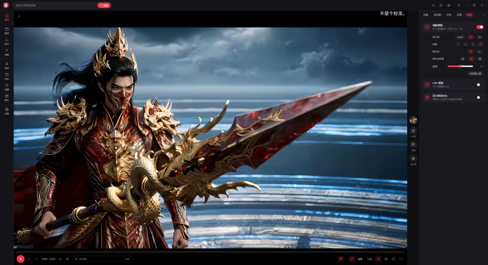
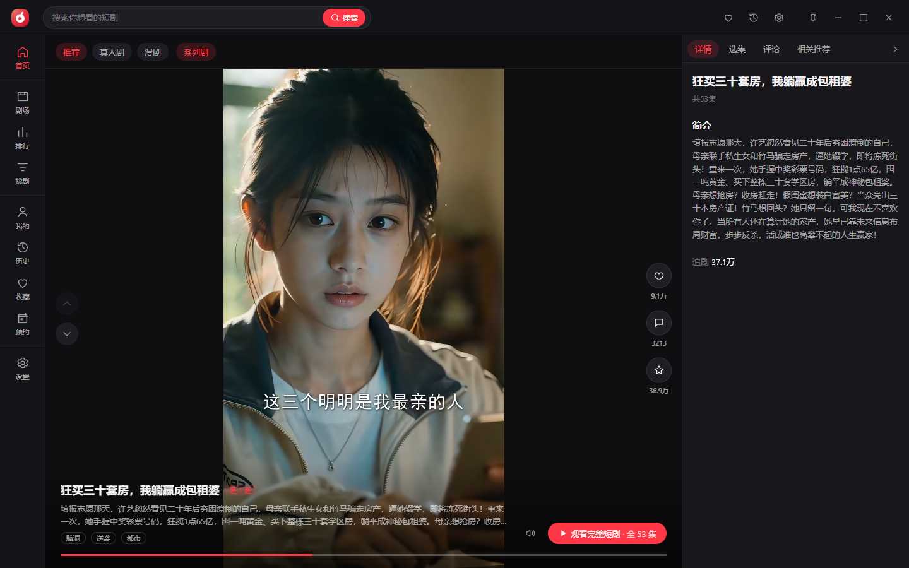
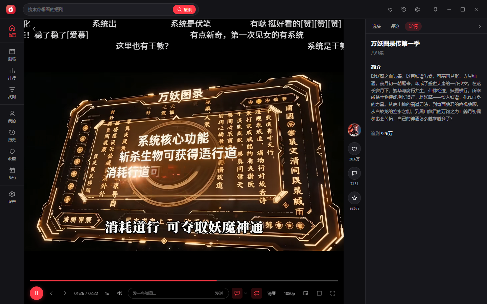
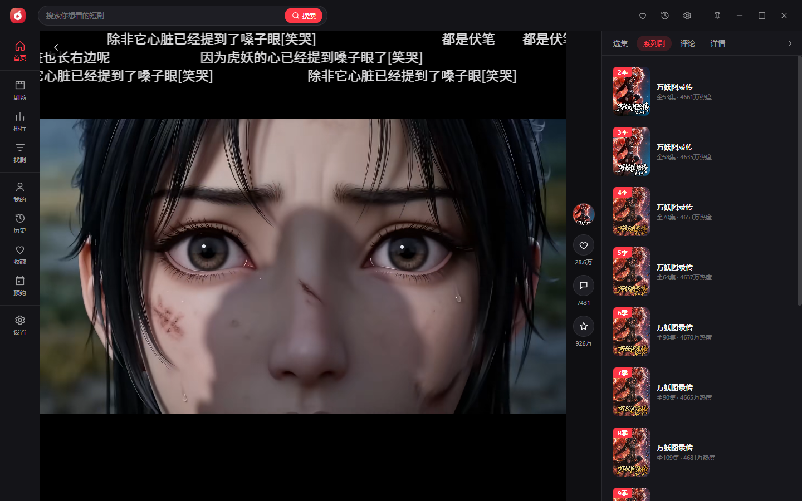
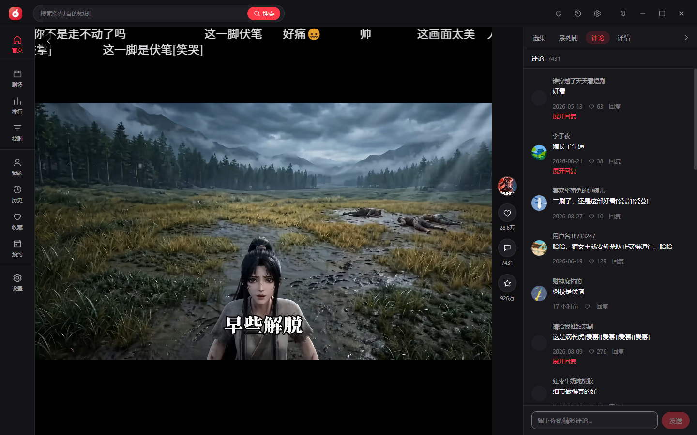
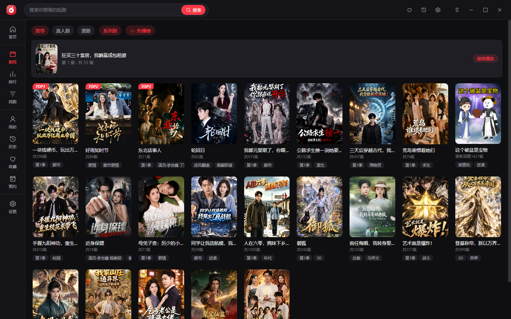
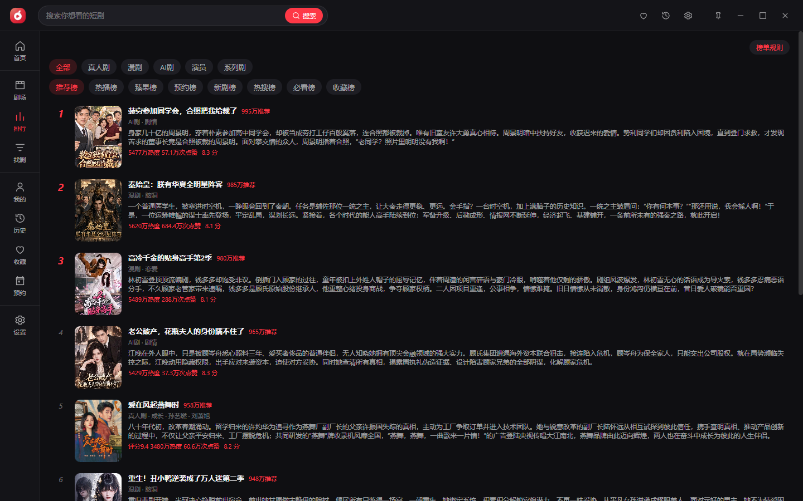
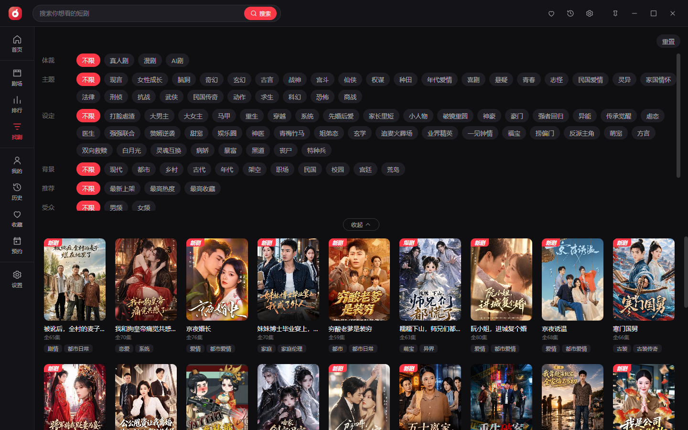
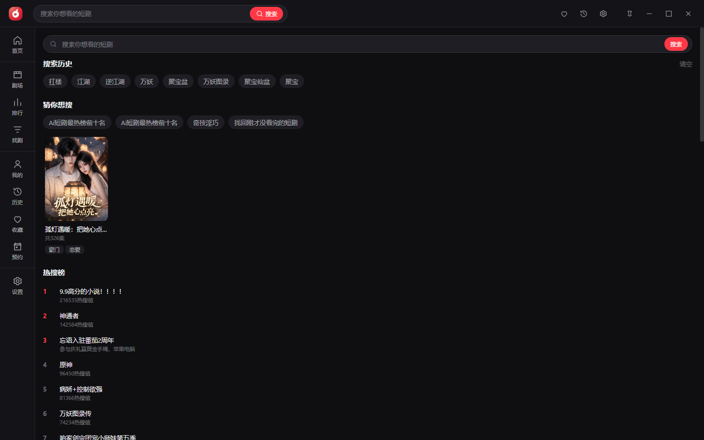
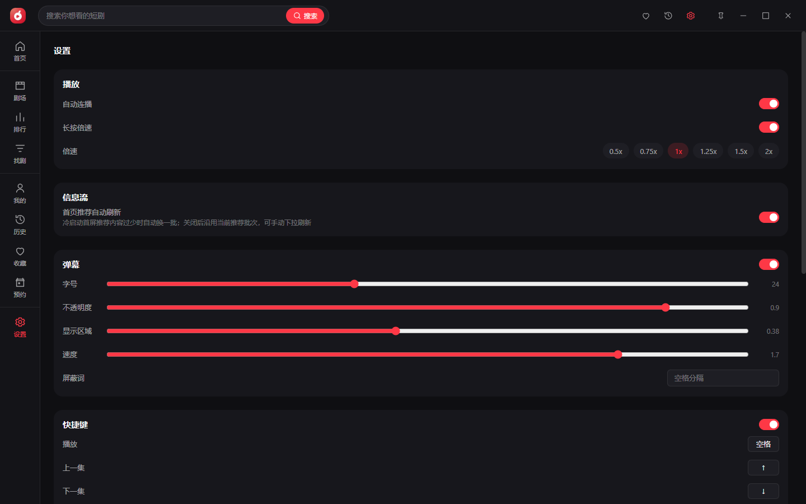

# 红果免费短剧（Windows 桌面端）

**[→ 下载最新版（国内加速）](https://gh-proxy.com/https://github.com/liangzai-kk/hongguo-short-drama-desktop/releases/download/v0.1.11/hongguo-short-drama-0.1.11.exe)**　[GitHub 发布页](https://github.com/liangzai-kk/hongguo-short-drama-desktop/releases/latest)　Windows 10 1809+ · x64 · 约 559 MB

非官方第三方桌面客户端，**播放中可实时超分**（1080P 源直上 2K / 4K）。因版权原因，本仓库只发布编译好的可执行文件与文档，**不公开源代码**。

---

## 画质增强 · 实时超分

**播放中实时超分**：用显卡厂商的官方算法逐帧增强，1080P 的源直接上 2K / 4K，
边缘、纹理与高光在播放时重建出来 —— 不写临时文件、不额外等待，切集照样接着看。
质量四档 + 锐度可调；算力跟不上自动降档，显卡不支持时静默回落原画面，播放不受影响。
超分支持 NVIDIA 超分 / DLSS-SR 与 AMD FSR 等后端，具体可用档位随显卡与驱动而定；补帧目前为 NVIDIA 显卡。

同一帧的对比（点开看大图）：

---

## 界面

截图中的剧集名称、海报、画面与评论内容，版权归其权利人所有，仅用于说明软件界面。

---

## 功能

| 模块 | 亮点 |
| --- | --- |
| 首页信息流 | **接入官方推荐系统**：推荐 / 真人剧 / 漫剧 / 系列剧 / 热播榜五路内容；进中栏即播；服务端下发的角标与推荐标签 |
| 推荐系统 | 曝光与点击实时回传，推荐结果跟着你的观看与点击走；换一批、滚动续拉、待上线剧上线后置顶 |
| 剧场 / 排行 / 找剧 | 分类信息流、一级 / 二级榜单（含演员榜）、筛选项与榜单规则全部由服务端下发 |
| 搜索 | 关键词搜索，多路召回；搜索框联想下拉（空框给最近搜索，打字给联想）；猜你想搜与热搜榜；结果按系列归并，搜一部剧直接列出它的全部季；历史与清空 |
| 详情 / 系列剧 | 同一系列各季自动归组、按季号排序、番外排在正片之后、未上线季可就地预约 |
| 播放 | 多档清晰度切换（切档保持进度、选过的档位下一集也沿用）、相邻集预解码、进度记录与续播、播完自动连播；可选独立窗口或应用内播放 |
| 弹幕 | 真实观众弹幕，跟随播放进度实时出现；可发送、清屏；开关 / 字号 / 不透明度 / 显示区域 / 速度 / 屏蔽词 |
| 评论 | 真实昵称与头像、最热 / 最新排序、回复详情页、长文折叠、点赞、草稿按集保存；登录后内容进账号，未登录保存在本机 |
| 我的 | 收藏 / 历史 / 点赞 / 预约（已预约 / 即将上线 / 已上线三栏），历史可按剧名检索，列表可单条删除；登录后与账号同步，未登录保存在本机 |
| 金币 | 余额与任务列表、7 日签到与奖励领取、看剧攒金币 |
| 画质增强 **（亮点）** | **实时超分与补帧**：播放中逐帧走显卡厂商官方算法，1080P 源直上 2K / 4K（质量档位 + 锐度）；NVIDIA 超分 / FSR / DLSS-SR 等后端自动选；不写临时文件、不额外等待；算力跟不上自动降档，显卡不支持时静默回落原画面 |
| 本地数据 | 一键导出 / 导入（换设备迁移）：历史与分集进度、收藏、点赞、预约、自发评论与弹幕、搜索历史、草稿、播放偏好；清除本地数据单独确认 |
| 窗口 | 小窗态（画面窄窗、可置顶拖动）、铺满窗口、全屏、置顶、自定义快捷键、右键操作菜单 |
| 更新 | 设置页检查新版本，直接下载安装 |

完整清单与各项支持程度见 [docs/features.md](docs/features.md)。

---

## 更新记录

### 0.1.11

- 新增「金币」：余额与任务列表、7 日签到与奖励领取、看剧攒金币。
- 新增「点赞」：「我的 → 点赞」按集展示、可取消；播放页与原生播放窗点赞；评论点赞。
- 评论模块重做：最热 / 最新排序、回复详情页、长文折叠、按集草稿、头像与空态。
- 新增顶栏账号区、播放窗口设置（独立窗口 / 应用内）、首页信息流角标与推荐标签、系列剧未上线季预约入口。
- 原生播放窗新增右缘操作栏（点赞 / 评论 / 收藏）。
- 账号数据改为本地缓存 + 后台更新，历史、收藏、预约进入即显示；观看历史进入播放、切集即记录。
- 原生播放窗音画链路与窗口交互优化：音画读取与音频时钟、标题栏拖动 / 最大化 / 全屏 / 铺满态窗口键、控制条半透明浮层、浮层随窗口移动。
- 画质增强切档更顺滑，补帧闪烁与卡顿减少；弹幕字重与对比度提升。
- 修复播放中没声音 / 断续、看一半跳集、拖动进度条回退重解、补帧没声音 / 卡顿 / 闪烁、倍速杂音、暂停后音画不同步、切超分档崩溃、全屏退不出、控制条遮挡字幕等问题。

### 0.1.10

- 播放画面改用 Qt 原生播放窗口。
- 实时超分接入渲染性能优化；NVIDIA 超分 / FSR / DLSS-SR 三种后端自动选。

### 0.1.9

- 修复全屏时开关画质增强不生效。
- 修复全屏下 Esc 退不出去。
- 修复点过控制条按钮后空格等快捷键失效。
- 实时超分帧率稳定性优化：新增输入分辨率档位、取帧并行、自动降级改为先降质量再降档位。

### 0.1.8

- 新增实时超分（画质增强，默认关闭，设置页手动开）：播放中逐帧走显卡官方算法，1080P 源直上 2K / 4K，四档质量 + 锐度可调；不写临时文件、不额外等待，算力跟不上自动降到低一档。
- 增强面板附带锐度调节；补帧与 HDR 转换默认关闭。
- 显卡不支持或缺少运行组件时增强不生效，画面自动回落原视频，播放本身不受影响。
- 修复开启增强后画面闪烁、掉帧：取帧改到独立线程里做，主界面不再被拖慢。
- 修复窗口缩放、右栏收起、切换小窗后增强画面错位或出现重影。
- 设置页滑杆拖动过程中不再反复触发保存；暂停时调节增强参数立刻生效。

### 0.1.7

- 新增本地数据导出 / 导入：历史与分集进度、收藏、预约、自己发的评论与弹幕、搜索历史、评论草稿、播放偏好，一次搬到新机器；导出是一个压缩备份文件（原先的明文备份动辄几 MB），旧版本导出的备份照样能导进来。
- 导出完成会告诉你导出了哪个文件、多大，并给一个「在文件夹中显示」，一步跳到文件所在位置。
- 导入分两步走：先选文件，再确认（确认框里带上刚选中的文件名）；导入完成汇总每个分区实际搬进来多少条。
- 清除本地数据从导出 / 导入那一排里挪出来，独占一行并用分隔线隔开，点它先确认 —— 原先手一滑就点到。
- 设置页「本地数据」分区给出实时条数（历史 / 收藏 / 预约）；正在进行的动作只让自己转圈，另一个照常可点。
- 预约页拆成「已预约 / 即将上线 / 已上线」三栏，进来默认停在「已预约」；「即将上线」不再和已经能看的剧混在一栏。
- 待上线的剧在卡片上就能预约 / 取消预约（原先得进详情，而未上线的剧详情打不开）；从详情或播放页返回预约页会先出上次那份清单，不再整页重刷。
- 详情页的播放按钮拆成「继续播放」和「播放（从头看）」：看过的剧接着上次看，想重看从头来点旁边那一颗。
- 进度条可以预览了：鼠标移到进度条上就能看到那一刻的画面，拖动时跟着走，想找哪一段不用一点点试。
- 修复两处历史丢失：播放中强制退出导致整部剧的记录消失；旧版本里看过的剧，升级后历史里一条都没有。
- 修复个别操作点了没反应：界面数据出后台通道时没能序列化过去，请求在发出前就丢了。
- 搜索历史的词条可以单条删除了（整组「清空」照旧）。

完整更新记录见 [CHANGELOG.md](CHANGELOG.md)。

---

## 安装

见 [docs/install.md](docs/install.md)。

## 文档

| 文件 | 内容 |
| --- | --- |
| [docs/features.md](docs/features.md) | 功能一览与各项实现程度 |
| [docs/install.md](docs/install.md) | 安装、卸载、升级、数据目录 |
| [docs/faq.md](docs/faq.md) | 常见问题 |

## 反馈

提 Issue，用仓库自带模板。不接受源码索取与功能定制请求。

---

## 声明

- **版权归属**：「红果短剧」「红果免费短剧」的名称、商标、标识、剧集内容及相关数据的一切权利，归红果短剧官方及其权利人所有。
- **项目性质**：非官方第三方客户端，与红果短剧官方及其关联公司**无任何关联**，未获其授权、许可或认可。
- **使用目的**：仅供个人学习、技术研究与交流，**禁止任何商业用途**。
- **下载后请于 24 小时内删除**；观看内容请使用官方 App。

完整条款见 [LICENSE](LICENSE) 与 [DISCLAIMER.md](DISCLAIMER.md)。
