# 红果免费短剧（Windows 桌面端）

  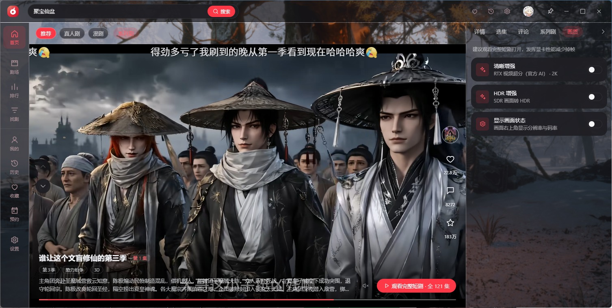

  <b>非官方桌面客户端</b> · 实时超分 · 智能补帧 · 弹幕与评论 
  Windows 10 1809+ · x64 · 约 548 MB · 只发布安装包与文档，不含源码

  
  

国内直连 GitHub 很慢，下载请用下面的加速线路。

## 下载

| 线路 | 链接 |
| --- | --- |
| **加速下载（推荐）** | **[hongguo-short-drama-0.1.13.exe](https://gh-proxy.com/https://github.com/liangzai-kk/hongguo-short-drama-desktop/releases/download/v0.1.13/hongguo-short-drama-0.1.13.exe)** |
| 加速备用 | [hongguo-short-drama-0.1.13.exe](https://ghproxy.net/https://github.com/liangzai-kk/hongguo-short-drama-desktop/releases/download/v0.1.13/hongguo-short-drama-0.1.13.exe) |
| GitHub 原链接 | [Releases v0.1.13](https://github.com/liangzai-kk/hongguo-short-drama-desktop/releases/latest) |

约 548 MB · Windows 10 1809+ x64。三条都是同一个安装包，前面的线路打不开再换下一条。

---

## 亮点

| 能力 | 说明 |
| --- | --- |
| **实时超分** | 播放中逐帧放大，720P / 1080P 的源直接出 2K / 4K；RTX 超分、DLSS、FSR 三种后端可选，质量四档 + 锐度可调。 |
| **智能补帧** | 2x / 3x / 4x 补帧，30fps 的短剧补到 60fps 以上。 |
| **Qt 独立播放窗** | 画面走 D3D12 硬件渲染，显卡吃满、界面主线程不参与，长时间播放不掉帧。 |
| **原生弹幕** | 真实弹幕跟随进度出现；可发送、清屏、屏蔽词，字号 / 速度 / 显示区域可调。 |
| **功能完整** | 首页、剧场、排行、找剧、搜索、详情、选集、系列剧、评论、表情、预约、收藏、历史，全部是 App 的真实数据。 |
| **可换外观** | 五套主题、自定义背景图、毛玻璃 / 液态玻璃；历史、收藏、进度存本机，可导出换设备。 |

---

## 画质增强

同一帧、同一处画面，关闭与开启超分各截一张（源 1280×720，超分到 4K、质量超高）：

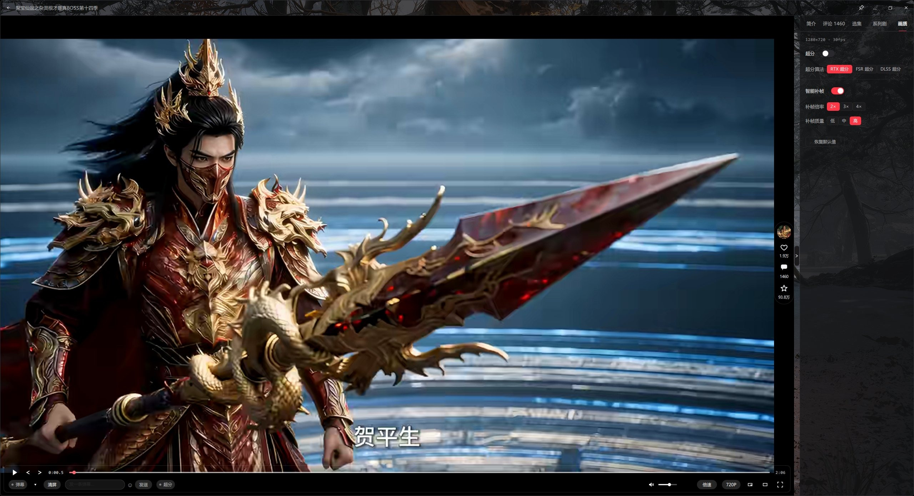

局部按原始像素 1:1 对比，左关右开——铠甲纹路、发丝和面具细节从糊成一片变成根根分明：

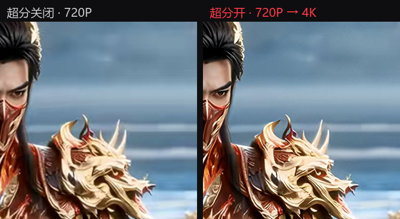

播放器右栏「画质」里调节：

- 超分算法：RTX 超分 / DLSS / FSR
- 超分到：1080P / 2K / 4K
- 质量：低 / 中 / 高 / 超高
- 智能补帧：2x / 3x / 4x，补帧质量单独调

显卡不支持或算力跟不上时自动降档，播放不受影响。

---

## 界面

<table>
  <tr>
    <td width="50%">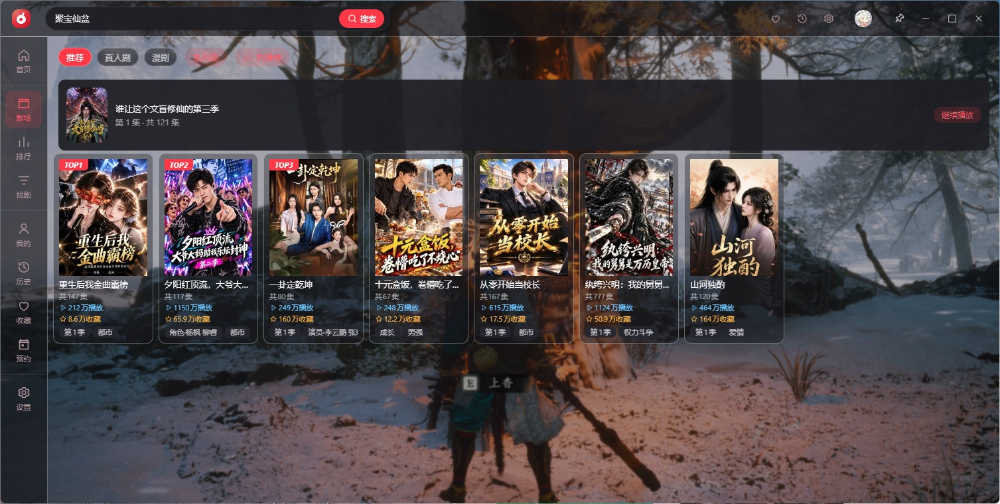</td>
    <td width="50%">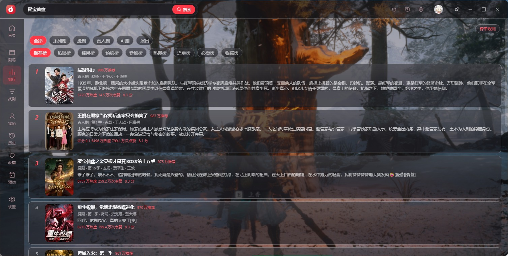</td>
  </tr>
  <tr>
    <td><b>剧场</b>　分类信息流，卡片直接给集数、简介与热度</td>
    <td><b>排行</b>　一级 / 二级榜单切换，榜内直接显示演员条目</td>
  </tr>
  <tr>
    <td>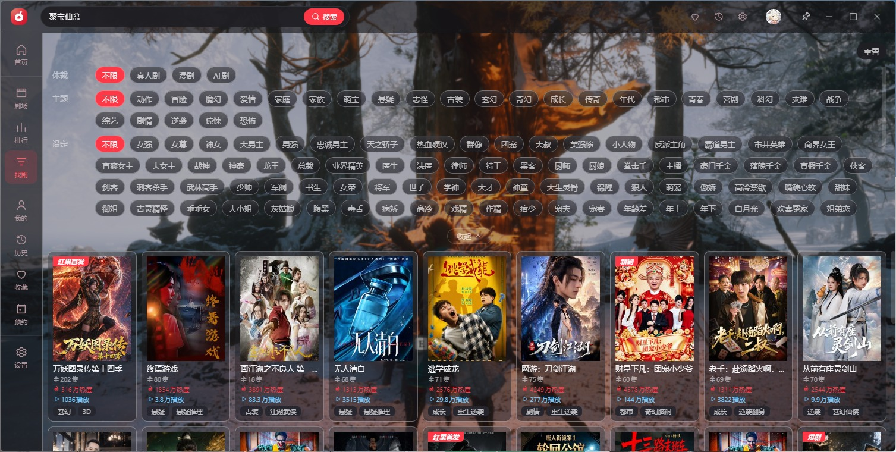</td>
    <td>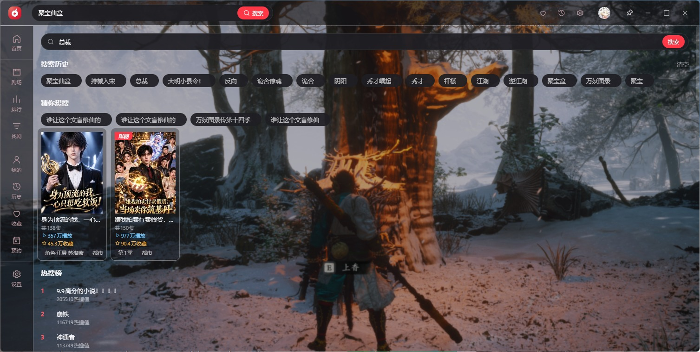</td>
  </tr>
  <tr>
    <td><b>找剧</b>　体裁、主题、设定全部摊开，选完即出结果</td>
    <td><b>搜索</b>　联想下拉、猜你想搜、热搜榜，结果按系列归并</td>
  </tr>
  <tr>
    <td>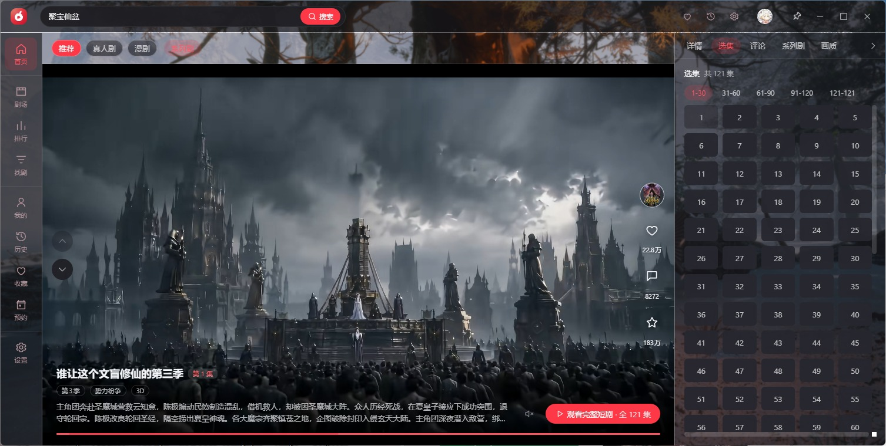</td>
    <td>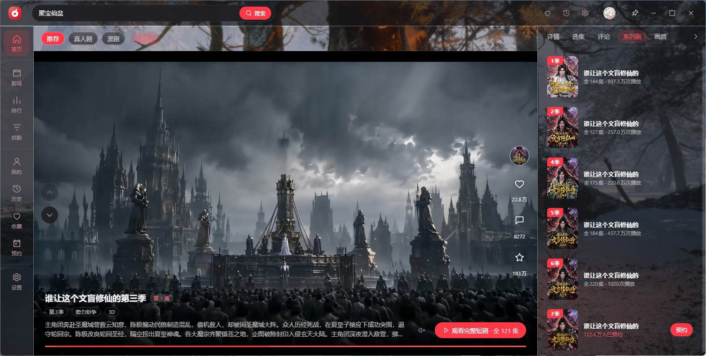</td>
  </tr>
  <tr>
    <td><b>选集</b>　按区间分段，当前集直接标出</td>
    <td><b>系列剧</b>　各季自动归组，未上线的季可就地预约</td>
  </tr>
  <tr>
    <td>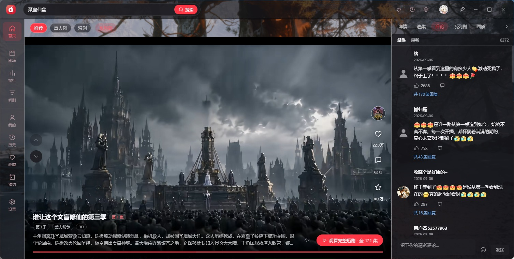</td>
    <td>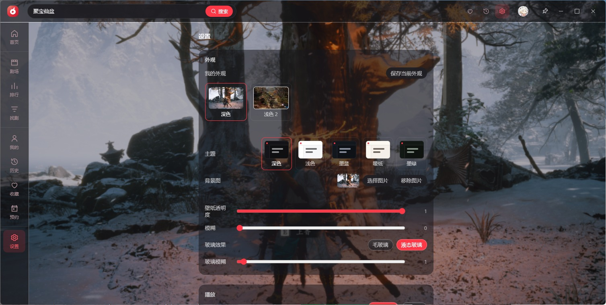</td>
  </tr>
  <tr>
    <td><b>评论</b>　真实昵称头像，最热 / 最新，回复、点赞、表情</td>
    <td><b>外观</b>　主题、背景图、透明度、模糊、玻璃效果</td>
  </tr>
</table>

截图中的剧集名称、海报、画面与评论内容，版权归其权利人所有，仅用于说明软件界面。

---

## 功能

| 模块 | 说明 |
| --- | --- |
| 首页 | 推荐、真人剧、漫剧、系列剧、热播榜五路内容，进中栏即播 |
| 推荐 | 曝光与点击实时回传；换一批、滚动续拉、待上线剧上线后置顶 |
| 播放 | 多档清晰度（切档保持进度）、相邻集预解码、进度续播、播完连播；独立窗口或应用内可选 |
| 画质 | 实时超分 2K / 4K，四档质量 + 锐度；智能补帧 2x / 3x / 4x |
| 弹幕 | 真实弹幕、发送、清屏、屏蔽词、字号 / 不透明度 / 速度 / 显示区域 |
| 评论 | 最热 / 最新、回复、点赞、长文折叠、按集草稿，自己发的可删 |
| 表情 | 评论与弹幕自带 53 个官方表情 |
| 详情 | 各季自动归组、按季号排序、番外排在正片之后、未上线季预约 |
| 我的 | 收藏 / 历史 / 点赞 / 预约，列表可单条删除，登录后与账号同步 |
| 外观 | 五套主题、背景图、毛玻璃；原生播放窗同一套配色 |
| 登录 | 抖音一键登录（默认扫码），短信备用 |
| 本地数据 | 历史、收藏、点赞、预约、自发内容、搜索历史、草稿、偏好，一键导出 / 导入 |
| 窗口 | 小窗（可置顶拖动）、铺满、全屏、置顶、自定义快捷键、右键菜单 |
| 更新 | 设置页检查新版本，直接下载安装 |

完整清单与各项支持程度见 [docs/features.md](docs/features.md)。

---

## 安装

1. 用上面的[加速下载](https://gh-proxy.com/https://github.com/liangzai-kk/hongguo-short-drama-desktop/releases/download/v0.1.13/hongguo-short-drama-0.1.13.exe)拿到 `hongguo-short-drama-0.1.13.exe`（约 548 MB）。
2. 双击运行。Win10 / Win11 可能弹 SmartScreen，点「更多信息 → 仍要运行」。
3. 安装目录可改（默认装当前用户目录，不需要管理员权限）。升级直接覆盖安装，播放记录与收藏都保留。

首次运行、数据目录（`%APPDATA%\红果免费短剧`）、卸载与常见异常见 [docs/install.md](docs/install.md)。

---

## 更新记录

### 0.1.13

- 扫码登录改用红果官方网页：手机用红果短剧 App 扫一扫即登，云端播放记录、收藏、预约自动同步。
- 二维码支持点击放大：整屏白底大码，扫码相机不再过曝。
- 打开登录框前已预先把码取好，点「扫码登录」几乎立刻出码；官方页每 60 秒换码时界面跟着换。
- 修复退出登录后再次扫码必定失败。
- 修复安装完成后被要求立即重启电脑。

### 0.1.12

- 新增「外观」：五套主题、背景图与透明度 / 模糊、毛玻璃与液态玻璃，可存成预设一键切回。
- 登录改为抖音一键登录（默认扫码），新增换设备重置本机身份。
- 评论与弹幕支持 53 个官方表情；自己的评论与回复可删。
- 服务器时间校准，本机时间不准时不再影响登录与播放。
- 设备注册不再每次启动都做，启动与切集更快。
- 修复点开某一集后没播、直接跳到下一集。
- 修复装更新时应用先被杀掉、安装中途中断。

完整更新记录见 [CHANGELOG.md](CHANGELOG.md)。

---

## 文档

| 文件 | 内容 |
| --- | --- |
| [docs/features.md](docs/features.md) | 功能一览与各项实现程度 |
| [docs/install.md](docs/install.md) | 安装、卸载、升级、数据目录 |
| [docs/faq.md](docs/faq.md) | 常见问题 |

## 反馈

提 Issue，用仓库自带模板。不接受源码索取与功能定制请求。

---

## 声明

- **版权归属**：「红果短剧」「红果免费短剧」的名称、商标、标识、剧集内容及相关数据的一切权利，归红果短剧官方及其权利人所有。
- **项目性质**：非官方第三方客户端，与红果短剧官方及其关联公司**无任何关联**，未获其授权、许可或认可。
- **使用目的**：仅供个人学习、技术研究与交流，**禁止任何商业用途**。
- **下载后请于 24 小时内删除**；观看内容请使用官方 App。

完整条款见 [LICENSE](LICENSE) 与 [DISCLAIMER.md](DISCLAIMER.md)。
