# 红果免费短剧（Windows 桌面端）

  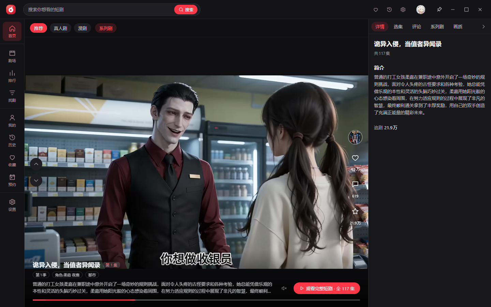

  <b>非官方第三方桌面客户端</b> · 播放中实时超分 · 弹幕、评论、剧场、排行全在桌面端 
  Windows 10 1809+ · x64 · 约 548 MB · 因版权原因只发布可执行文件与文档，不公开源代码

  
  

第一个是国内加速镜像；连 GitHub 顺畅的话两个链接是同一个安装包。

---

## 特点

- **实时超分**：播放中逐帧走显卡厂商的官方算法，1080P 源直接上 2K / 4K，不写临时文件、不转码、不额外等待。
- **像真机一样跑**：首页推荐、剧场、排行、找剧、搜索、详情、播放、评论、弹幕全部走 App 接口，推荐与反滤信息按官方规则回传。
- **该有的都有**：多档清晰度、相邻集预解码、进度续播与自动连播、弹幕（发送 / 清屏 / 屏蔽词）、评论（最热 / 最新 / 回复 / 点赞 / 表情）。
- **可换外观**：五套主题、自定义背景图、毛玻璃 / 液态玻璃，整套存成预设一键切回，原生播放窗跟着同一套配色。
- **数据在本地**：历史、收藏、点赞、预约、草稿、搜索历史存在本机 sqlite，可一键导出 / 导入换设备，也可整组清除。

---

## 画质增强 · 实时超分

用显卡厂商的官方算法逐帧增强：边缘、纹理与高光在播放时重建出来，1080P 的源直接上 2K / 4K。
质量四档 + 锐度可调；算力跟不上自动降档，显卡不支持时静默回落原画面，播放不受影响。
超分在 NVIDIA 超分 / FSR / DLSS-SR 三种后端里自动选，具体可用档位随显卡与驱动而定；补帧需要厂商运行组件，与 HDR 转换一样默认关闭。

同一帧的两版画面（点开可看原图对比细节）：

**增强关闭**

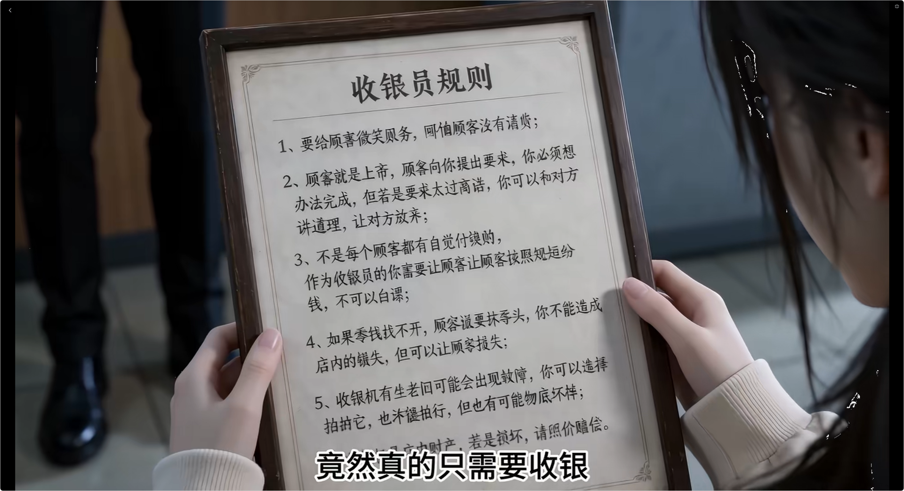

**增强开启（2K 超分）**

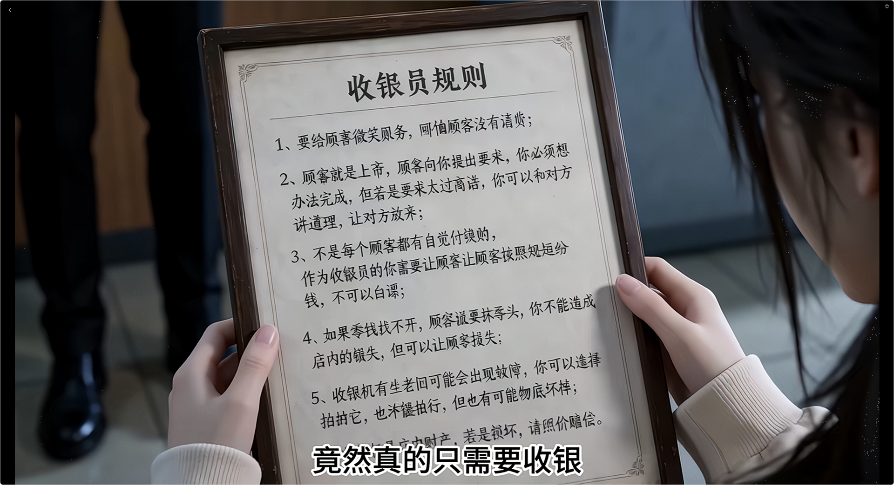

同一帧同一处文字按原始像素截出的对比（上：增强关闭，下：增强开启）——笔画边缘从糊成一片变成根根分明：

面板在播放页右栏「画质」里，开关、超分档位、质量、输入分辨率、锐度都在这一处调：

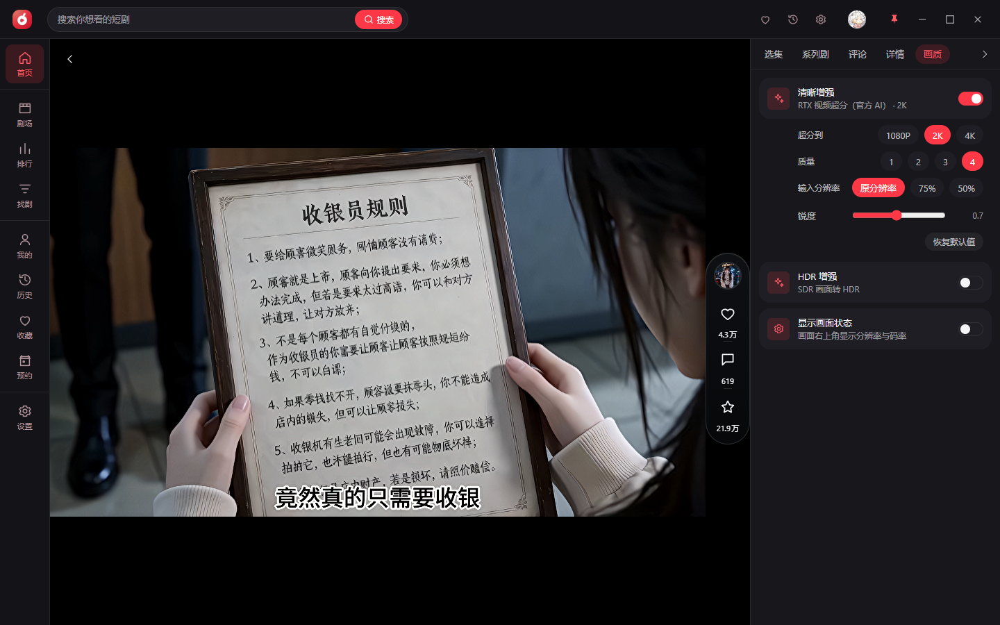

---

## 界面

### 发现

首页（见页首截图）是一屏一部剧的沉浸信息流：进中栏即播，右栏跟着当前这部剧走。

剧场按类别给分类信息流，卡片上直接给集数与简介：

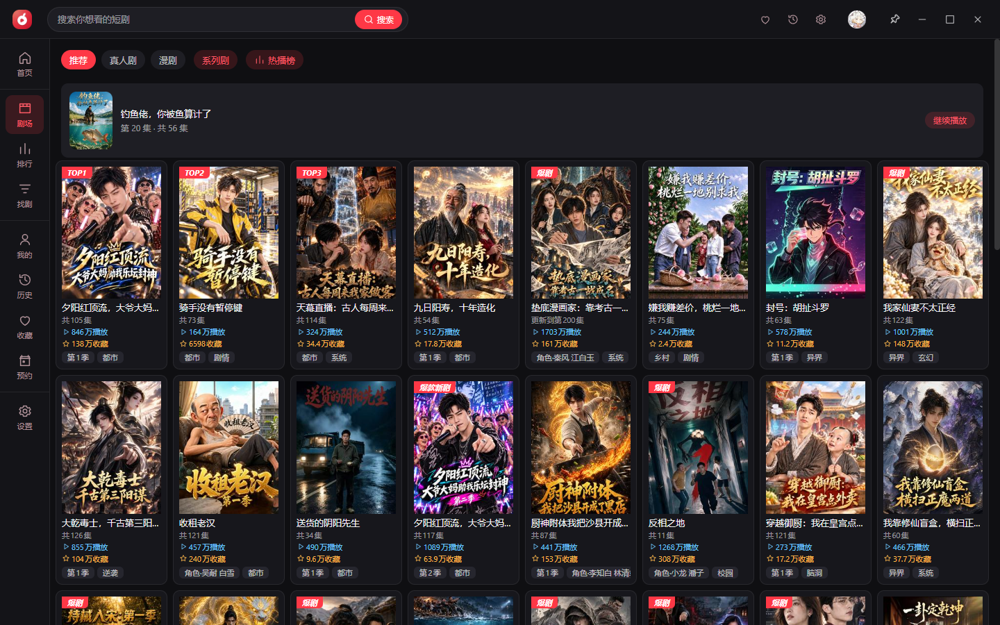

排行榜按服务端下发的榜单切换，名次与上榜条目直接来自榜单：

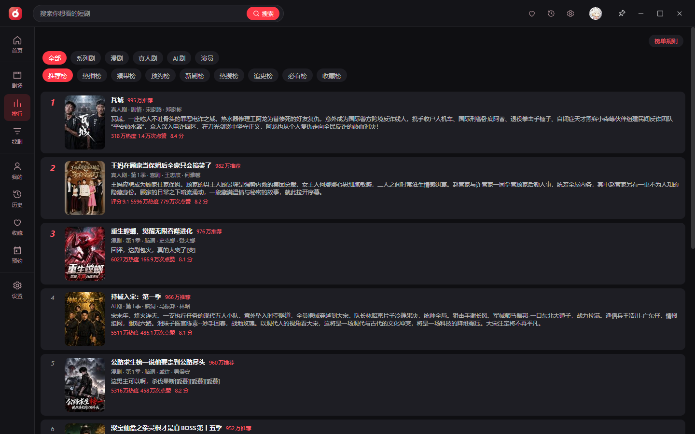

找剧把筛选项全部摊开，选完即出结果：

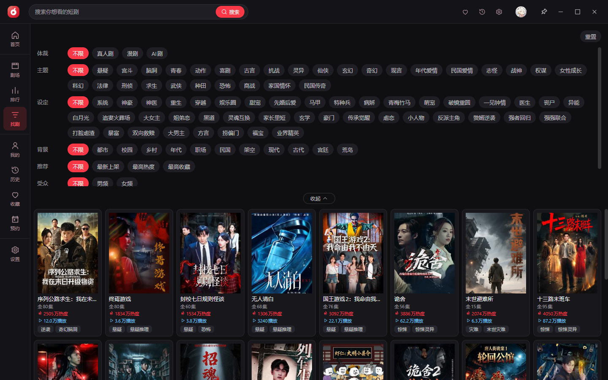

搜索结果按系列归并，搜一部剧能直接列出它的全部季：

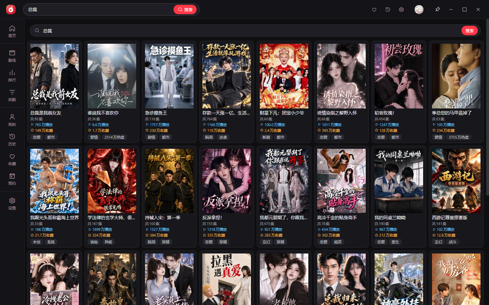

### 播放

播放页：左侧画面，右栏在「选集 / 系列剧 / 评论 / 详情 / 画质」之间切换，底部是播放控制条：

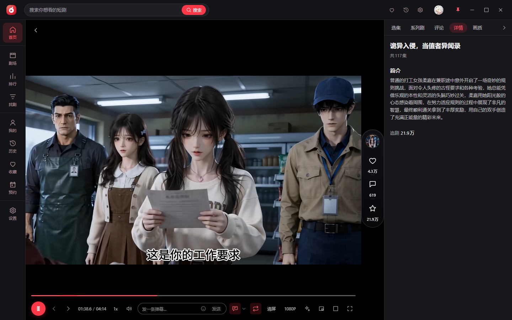

选集按区间分段，当前集直接标出来：

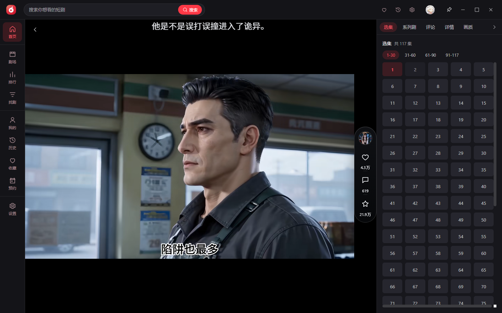

同一系列的各季自动归组，未上线的季可以就地预约：

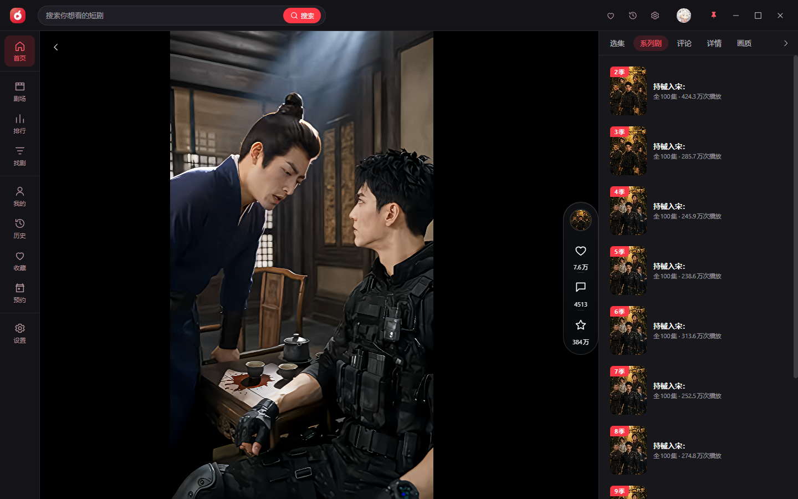

评论给真实昵称与头像，最热 / 最新两种排序，回复、点赞、官方表情：

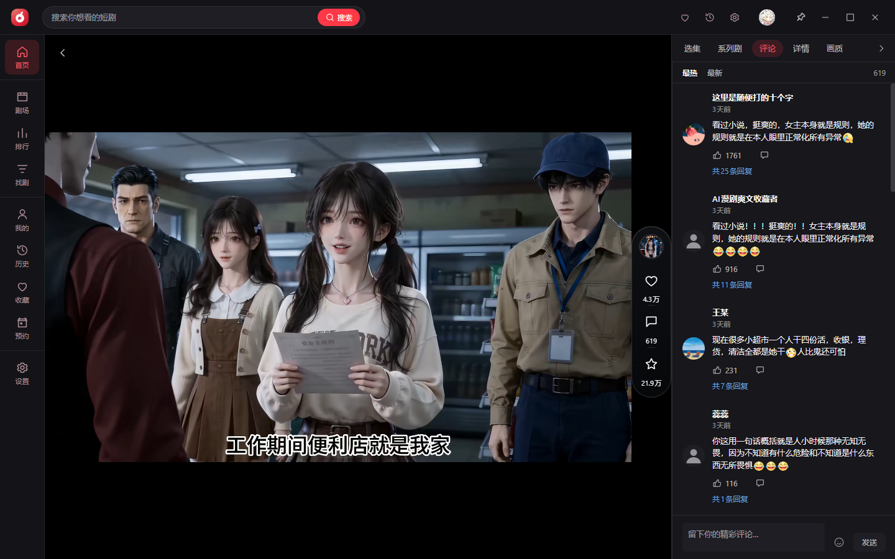

小窗：窗口收成一扇只装画面的窄窗，可置顶、可拖动，其余照常播：

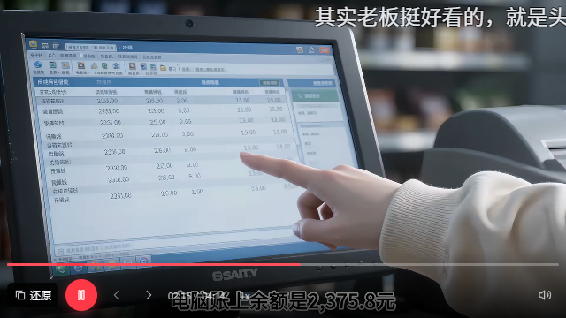

### 设置

设置页：外观（主题 / 背景图 / 玻璃效果 / 我的外观）、播放窗口、倍速、快捷键、本地数据都在这一页：

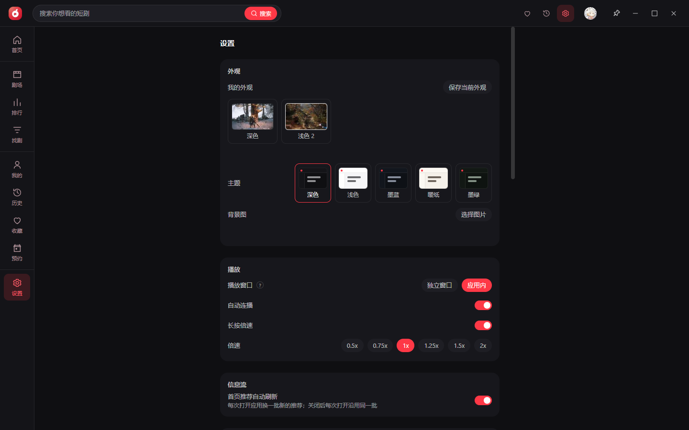

截图中的剧集名称、海报、画面与评论内容，版权归其权利人所有，仅用于说明软件界面。

---

## 功能

| 模块 | 说明 |
| --- | --- |
| 首页信息流 | 推荐 / 真人剧 / 漫剧 / 系列剧 / 热播榜五路内容；进中栏即播；服务端下发的角标与推荐标签 |
| 推荐系统 | 曝光与点击实时回传；换一批、滚动续拉、待上线剧上线后置顶 |
| 剧场 / 排行 / 找剧 | 分类信息流；一级 / 二级榜单切换，榜内直接显示演员条目；筛选项与榜单规则由服务端下发 |
| 搜索 | 关键词搜索多路召回；联想下拉（空框给最近搜索）；猜你想搜与热搜榜；结果按系列归并；历史可单条删除 |
| 详情 / 系列剧 | 各季自动归组、按季号排序、番外排在正片之后、未上线季就地预约 |
| 播放 | 多档清晰度（切档保持进度、选过的档位下一集沿用）、相邻集预解码、进度续播、播完连播；独立窗口或应用内播放可选 |
| 弹幕 | 真实观众弹幕跟随进度出现；可发送、清屏；开关 / 字号 / 不透明度 / 显示区域 / 速度 / 屏蔽词 |
| 评论 | 真实昵称与头像、最热 / 最新、回复详情页、长文折叠、点赞、按集草稿；自己发的可删；未登录存本机 |
| 表情 | 评论与弹幕自带 53 个官方表情，输入框里显示成表情图，发出后也是表情图 |
| 我的 | 收藏 / 历史 / 点赞 / 预约（已预约 / 即将上线 / 已上线三栏），列表可单条删除；登录后与账号同步 |
| 外观 | 五套主题；自定义背景图与透明度、模糊；毛玻璃 / 液态玻璃；整套存成「我的外观」；原生播放窗同一套外观 |
| 登录 | 顶栏「登录」走抖音一键登录（登录框默认扫码，手机确认即登）；服务端要求时补图形验证码；短信备用；换设备可重置本机身份 |
| 画质增强 | 实时超分与补帧：1080P 源直上 2K / 4K，质量档位 + 锐度；NVIDIA 超分 / FSR / DLSS-SR 自动选；算力不足自动降档 |
| 本地数据 | 一键导出 / 导入（历史与分集进度、收藏、点赞、预约、自发内容、搜索历史、草稿、偏好）；清除单独确认 |
| 窗口 | 小窗态（可置顶拖动）、铺满窗口、全屏、置顶、自定义快捷键、右键菜单 |
| 更新 | 设置页检查新版本，直接下载安装 |

完整清单与各项支持程度见 [docs/features.md](docs/features.md)。

---

## 安装

1. 点上面的「下载」拿到 `hongguo-short-drama-0.1.12.exe`（约 548 MB）。
2. 双击运行。Win10 / Win11 可能弹 SmartScreen，点「更多信息 → 仍要运行」。
3. 安装时可以改目录（默认装在当前用户目录，不需要管理员权限）。升级直接覆盖安装，播放记录与收藏都保留。

首次运行、数据目录（`%APPDATA%\红果免费短剧`）、卸载与常见异常见 [docs/install.md](docs/install.md)。

---

## 更新记录

### 0.1.12

- 新增「外观」：五套主题、自定义背景图与透明度 / 模糊、毛玻璃与液态玻璃；调好的一整套可存成「我的外观」预设一键切回，原生播放窗跟随同一套配色。
- 登录主入口改为抖音一键登录（短信备用），新增抖音扫码登录（登录框默认扫码）；账号注销冷静期可恢复；新增换设备重置本机身份。
- 新增评论与弹幕的 53 个官方表情：输入框里直接显示成表情图，发出后评论与弹幕里也是表情图。
- 新增删除自己的评论与回复：悬停卡片右上角出现 ×，删掉立刻从列表消失。
- 服务器时间校准，本机时间不准时不再影响登录与播放；播放进度与账号数据跨设备同步。
- 设备注册不再每次启动都做，启动与切集等待更短。
- 修复点开某一集后没播、直接跳到下一集。
- 修复装更新时应用先被杀掉、安装又中途中断（看起来像「应用自己卸载了」）：打开安装向导不再关应用，没装成会留在界面上给「重试」。
- 修复输入框里粘表情变成空方块、连粘多个只显示一个、中文输入法组词时上屏的字消失。
- 金币页下线：左栏入口与页面撤下，看剧攒金币的计时上报同步关闭。

完整更新记录见 [CHANGELOG.md](CHANGELOG.md)。

---

## 文档

| 文件 | 内容 |
| --- | --- |
| [docs/features.md](docs/features.md) | 功能一览与各项实现程度 |
| [docs/install.md](docs/install.md) | 安装、卸载、升级、数据目录 |
| [docs/faq.md](docs/faq.md) | 常见问题 |

## 反馈

提 Issue，用仓库自带模板。不接受源码索取与功能定制请求。

---

## 声明

- **版权归属**：「红果短剧」「红果免费短剧」的名称、商标、标识、剧集内容及相关数据的一切权利，归红果短剧官方及其权利人所有。
- **项目性质**：非官方第三方客户端，与红果短剧官方及其关联公司**无任何关联**，未获其授权、许可或认可。
- **使用目的**：仅供个人学习、技术研究与交流，**禁止任何商业用途**。
- **下载后请于 24 小时内删除**；观看内容请使用官方 App。

完整条款见 [LICENSE](LICENSE) 与 [DISCLAIMER.md](DISCLAIMER.md)。
